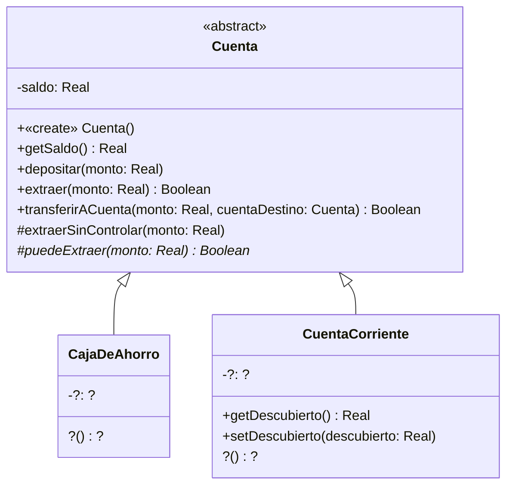

## Ejercicio 12: Cuenta con ganchos
Observe con detenimiento el diseño que se muestra en el siguiente diagrama. La clase cuenta es abstracta. El método puedeExtraer() es abstracto. Las clases CajaDeAhorro y CuentaCorriente son concretas y están incompletas.



### Implementación de `Cuenta`

```java
public Cuenta() {
    this.saldo = 0;
}

public double getSaldo() {
    return this.saldo;
}

public void depositar(double monto) {
    this.saldo += monto;
}

protected void extraerSinControlar(double monto) {
    this.saldo -= monto;
}

public boolean extraer(double monto) {
    if (this.puedeExtraer(monto)) {
        this.extraerSinControlar(monto);
        return true;
    }
    return false;
}

public boolean transferirACuenta(double monto, Cuenta cuentaDestino) {
    if (this.puedeExtraer(monto)) {
        this.extraerSinControlar(monto);
        cuentaDestino.depositar(monto);
        return true;
    }
    return false;
}
```

### Tarea A: Complete la implementación de las clases CajaDeAhorro y CuentaCorriente para que se puedan efectuar depósitos, extracciones y transferencias teniendo en cuenta los siguientes criterios. 

#### 1. Las cajas de ahorro solo pueden extraer y transferir cuando cuentan con fondos suficientes. 
#### 2. Las extracciones, los depósitos y las transferencias desde cajas de ahorro tienen un costo adicional de 2% del monto en cuestión (téngalo en cuenta antes de permitir una extracción o transferencia desde caja de ahorro).
#### 3. Las cuentas corrientes pueden extraer aún cuando el saldo de la cuenta sea insuficiente. Sin embargo, no deben superar cierto límite por debajo del saldo. Dicho límite se conoce como límite de descubierto (algo así como el máximo saldo negativo permitido). Ese límite es diferente para cada cuenta (lo negocia el cliente con la gente del banco). 
Cuando se abre una cuenta corriente, su límite descubierto es 0 (no olvide definir el constructor por default).

### Tarea B: Reflexione y discuta con el ayudante para responder a las siguientes preguntas.
#### 1. ¿Por qué cree que este ejercicio se llama "Cuenta con ganchos"? 
#### 2. En las implementaciones de los métodos extraer() y transferirACuenta()  que se ven en el diagrama, ¿quién es this? ¿Puede decir de qué clase es this?
#### 3. ¿Por qué decidimos que los métodos puedeExtraer() y extraerSinControlar tengan visibilidad "protegido"?
#### 4. ¿Se puede transferir de una caja de ahorro a una cuenta corriente y viceversa? ¿por qué? ¡Pruébelo!
#### 5. ¿Cómo se declara en Java un método abstracto? ¿Es obligatorio implementarlo? ¿Qué dice el compilador de Java si una subclase no implementa un método abstracto que hereda?

### Tarea C: Implemente en JUnit los siguientes tests de unidad. Para cada situación, cree los objetos necesarios, ejecute la operación y verifique el resultado retornado —cuando corresponda— y los saldos finales.
#### 1. Para la clase CajaDeAhorro
- depositar(): deposite \$100 en una caja de ahorro nueva. Verifique que el saldo sea \$98, luego de descontar el costo del 2%.
- extraer():
Deposite \$100, y luego extraiga \$50. Verifique que retorna true y que el saldo final sea \$47. (ya que se cobran 2\$ por el depósito y 1\$ por la extracción).
Con un saldo de \$100, intente extraer \$100. Verifique que retorna false y que el saldo permanezca en \$100, porque no alcanza para cubrir el costo adicional.
- transferirACuenta(): cree dos cajas de ahorro con saldo inicial de \$0 y deposite \$100 en la cuenta de origen. Verifique que su saldo sea \$98. Luego, realice estas operaciones en orden:
Intente transferir \$98 hacia la otra caja de ahorro. Verifique que retorne false, porque el saldo no alcanza para cubrir el monto más el costo adicional del 2%. Compruebe que los saldos permanezcan en \$98 para la cuenta de origen y \$0 para la de destino.
Transfiera \$50 hacia la misma cuenta de destino. Verifique que retorne true, que la cuenta de origen quede con \$47 (se descuentan \$50 más \$1 de costo) y que la cuenta de destino quede con \$49 (se descuenta el 2% del depósito recibido).
#### 2. CuentaCorriente
- depositar(): deposite \$100 en una cuenta corriente nueva. Verifique que el saldo sea \$100.
- extraer():
Con saldo de \$0 y límite de descubierto de \$500, extraiga \$300. Verifique que retorna true y que el saldo final sea −\$300.
Con saldo de \$0 y límite de descubierto de \$500, intente extraer \$600. Verifique que retorna false y que el saldo permanezca en \$0.
- transferirACuenta(): cree dos cuentas corrientes con saldo inicial de \$0 y establezca un límite de descubierto de \$200 en la cuenta de origen. Luego, realice estas operaciones en orden:
Intente transferir \$300 hacia la otra cuenta corriente. Verifique que retorne false, porque se supera el límite de descubierto. Compruebe que ambas cuentas mantengan su saldo en \$0.
Transfiera \$100 hacia la misma cuenta de destino. Verifique que retorne true, que la cuenta de origen quede con −\$100 y que la cuenta de destino quede con \$100.
Escriba un test para una transferencia desde una CuentaCorriente hacia una CajaDeAhorro y otro para una transferencia en sentido inverso. En cada caso, determine los saldos esperados de ambas cuentas y consulte con un ayudante para verificar que sean correctos.
