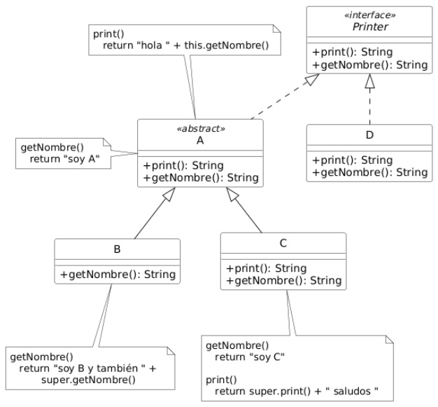

## Ejercicio 13: Tipos y binding dinámico
Dado el siguiente modelo, y los fragmentos de códigos mostrados, marque la respuesta para cada una de las preguntas enunciadas. Sólo una opción es la correcta.



Nota: Sugerimos resolver este ejercicio en papel, sólo con el diagrama, y luego verificar los resultados implementandolo en código

### Tarea 1: Observando el diagrama y dado el siguiente fragmento de código, responda (i) y (ii):

```java
__ o1 = new __();
o1.print();
o1.getNombre();
```

#### i- Indique la opción que incluye todos los tipos válidos con los que puede declararse la variable o1 para que el fragmento anterior sea válido en tiempo de compilación. 

1. A, B, C, D
2. Printer, A, C, D 

**3. Printer, A, B, C, D** ← ya que todas los tipos contienen las firmas de print() y getNombre(), B la hereda de A.

4. Printer, A, B, C    

##### ii- Suponiendo que o1 fue declarada de tipo Printer, indique la opción que incluye todos los tipos que pueden instanciarse y asignarse a la variable o1 en el fragmento anterior.

1. Printer, A, B, C, D
2. C, D
3. Printer, A, B, C

**4. B, C, D** ← Printer y A no pueden instanciarse por ser una interface y una clase abstracta.

### Tarea 2: Observando el diagrama, responda en (i) y (ii) qué texto retorna cada uno de los siguientes fragmentos de código:

#### i-
  
```java
  Printer p = new B();
  p.print();
```

1. hola soy A y también soy B
2. hola soy A

**3. hola soy B y también soy A**
4. hola soy B

#### ii-

```java
   A a = new C();
   a.print();
```

1. hola soy A

**2. hola soy C saludos** ← ```this``` siempre es el objeto que recibe el mensaje, así se use en un método de la superclase.

3. hola soy C
4. hola soy A saludos
