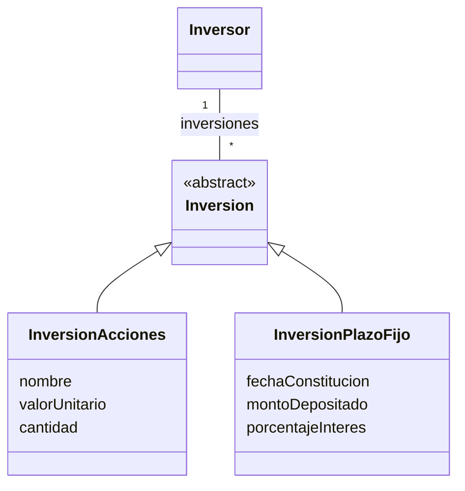
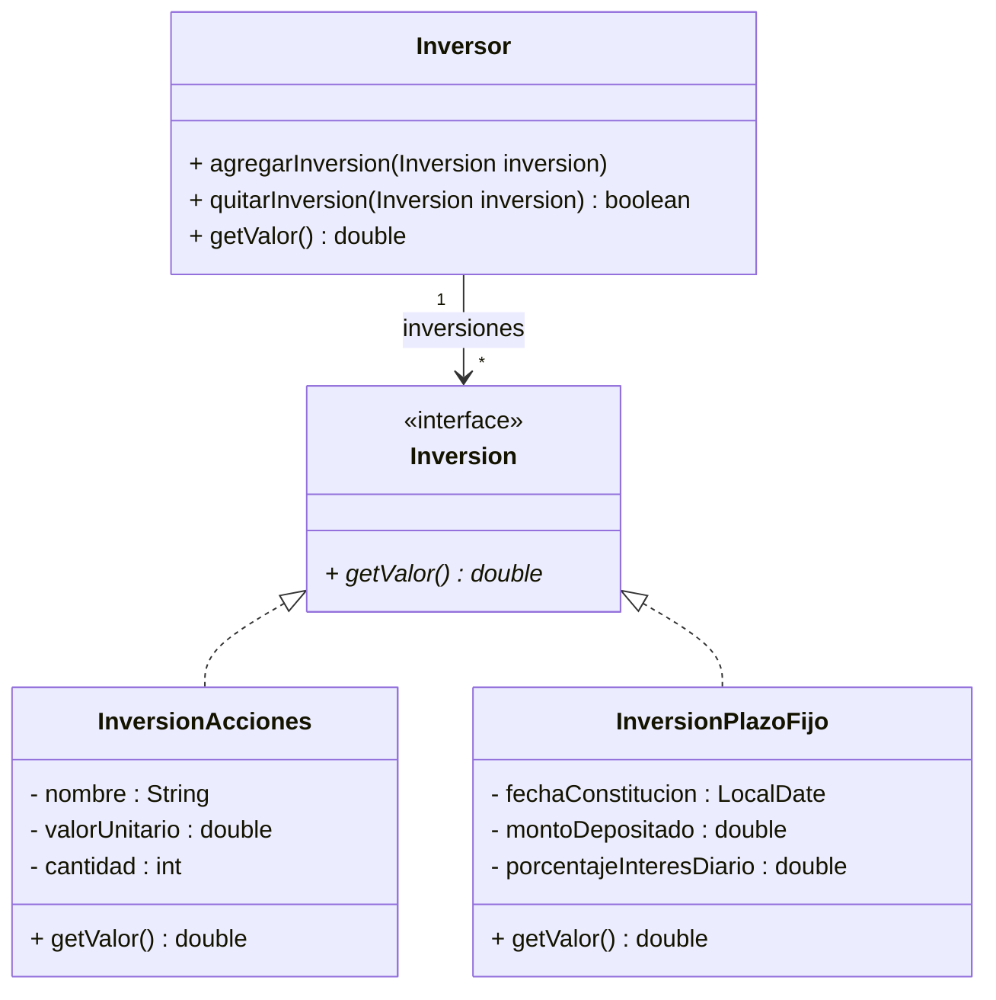

## Ejercicio 15: ¡A implementar Inversores! 

Retomando el Ejercicio 3, trabajamos en el diseño y modelado UML de un sistema de inversiones, donde definimos las clases, atributos y asociaciones necesarias para representar inversores y sus diferentes tipos de inversiones. Ahora es el momento de llevar el diseño a la práctica: vamos a implementar en Java lo diseñado y asegurar su calidad mediante pruebas automatizadas.

### Tareas:
### 1. Implemente
a. Realice el mapeo del modelo conceptual, a un diagrama de clases de UML. 

b. Implemente en Java lo necesario para que se pueda conocer el valor actual de cada inversión. Y también el monto total de las inversiones realizadas por un inversor.
### 2. Pruebas automatizadas
a. Diseñe los casos de prueba teniendo en cuenta los conceptos de valores de borde y particiones equivalentes vistos en la teoría.

b. Implemente utilizando JUnit los tests automatizados diseñados en el punto anterior.
### 3. Discuta con el ayudante
a. Consulte con un ayudante los casos de prueba diseñados
