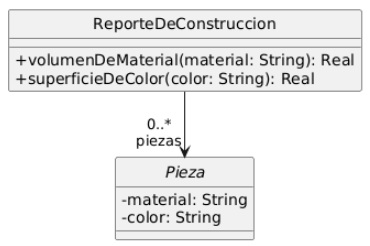

## Ejercicio 16: Volumen y superficie de sólidos

Una empresa siderúrgica quiere introducir en su sistema de gestión nuevos cálculos de volumen y superficie exterior para las piezas que produce. El volumen le sirve para determinar cuánto material ha utilizado. La superficie exterior le sirve para determinar la cantidad de pintura que utilizó para pintar las piezas.

El siguiente diagrama UML muestra el diseño actual del sistema. En el mismo puede observarse que un ReporteDeConstruccion tiene la lista de las piezas que fueron construidas. Pieza es una clase abstracta. 

### Tareas:
#### a) Complete el diseño e implemente
Su tarea es completar el diseño considerando que las piezas pueden ser **cilindros**, **esferas** o **prismas rectangulares**. 

Luego complete la implementación de la clase **ReporteDeConstruccion** siguiendo la especificación que se muestra a continuación:

_volumenDeMaterial(nombreDeMaterial: String)_: Recibe como parámetro un nombre de material (un string, por ejemplo 'Hierro'). Retorna la suma de los volúmenes de todas las piezas hechas en ese material.

_superficieDeColor(unNombreDeColor: String)_: Recibe como parámetro un color (un string, por ejemplo 'Rojo'). Retorna la suma de las superficies externas de todas las piezas pintadas con ese color.

**Fórmulas a utilizar:**

- **Cilindro**

    Volumen de un cilindro: π * radio 2 * h.

    Superficie de un cilindro: 2 * π * radio  * h + 2 * π * radio 2 

- **Esfera**

    Volumen de una esfera: ⁴⁄₃ * π * radio ³.

    Superficie de una esfera: 4 * π * radio 2

- **Prisma Rectangular**

    Volumen del prisma: ladoMayor * ladoMenor * altura

    Superficie del prisma: 2 * (ladoMayor * ladoMenor + ladoMayor * altura + ladoMenor * altura)

- Para obtener π, utilizamos Math.PI
- Para elevar un número a cualquier potencia, utilizamos Math.pow( numero: double, potencia: double ). Ej: 82  = Math.pow(8, 2) 

#### b) Pruebas automatizadas
Implemente los tests (JUnit) que considere necesarios.

#### c) Discuta con el ayudante
Es probable que note una similitud entre este ejercicio y el de "Figuras y cuerpos" que realizó anteriormente, ya que en ambos se pueden construir cilindros y prismas rectangulares. Sin embargo las implementaciones varían.  Enumere las diferencias y similitudes entre ambos ejercicios y luego consulte con el ayudante.
