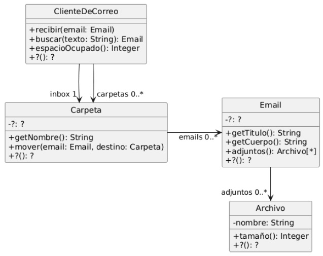
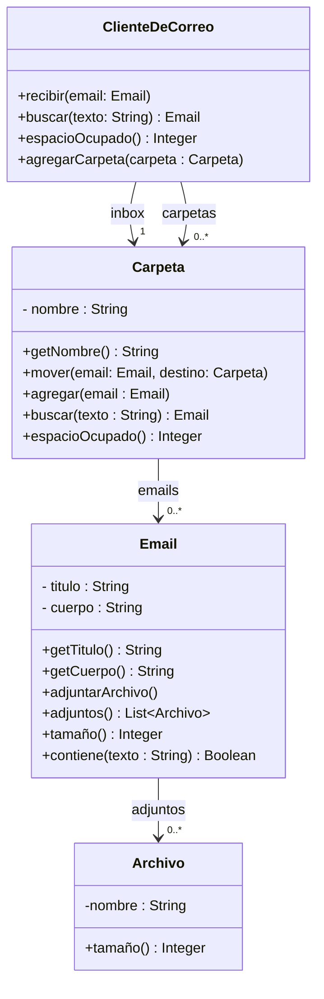

## Ejercicio 17: Cliente de Correo

El diagrama de clases de UML que se muestra a continuación documenta parte del diseño simplificado de un cliente de correo electrónico.

Su funcionamiento es el siguiente: 

- En respuesta al mensaje recibir, almacena en el inbox (una de las carpetas) el email que recibe como parámetro.

- En respuesta al mensaje mover, mueve el email desde una carpeta de origen a una carpeta destino (asuma que el email está en la carpeta origen cuando se recibe este mensaje). 

- En respuesta al mensaje buscar retorna el primer email en el Cliente de Correo cuyo título o cuerpo contienen el texto indicado como parámetro. Busca en todas las carpetas. 

- En respuesta al mensaje espacioOcupado, retorna la suma del espacio ocupado por todos los emails de todas las carpetas.

- El tamaño de un email es la suma del largo del título, el largo del cuerpo, y del tamaño de sus adjuntos.

- Para simplificar, asuma que el tamaño de un archivo es el largo de su nombre.

### Tareas:
### a) Modele e implemente
1. Complete el diseño y el diagrama de clases UML.

2. Implemente en Java la funcionalidad requerida.
### b) Pruebas automatizadas
1. Diseñe los casos de prueba teniendo en cuenta los conceptos de valores de borde y particiones equivalentes vistos en la teoría.
2. Implemente utilizando JUnit los tests automatizados diseñados en el punto anterior
