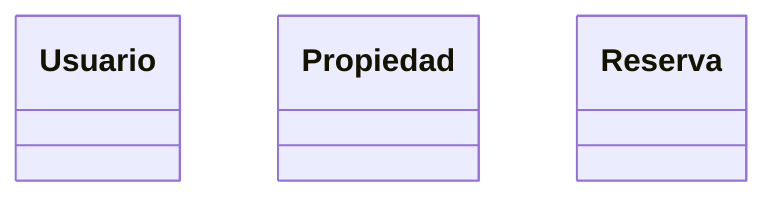
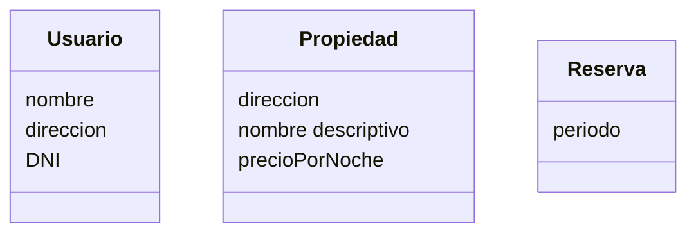
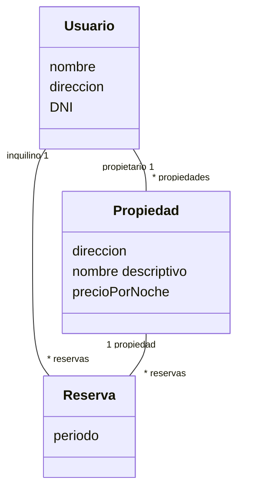
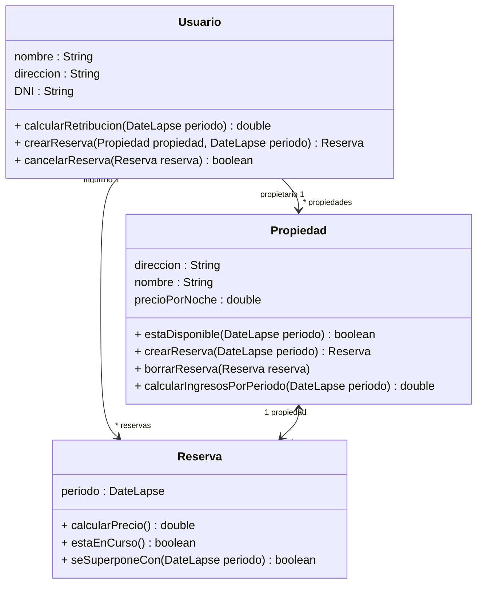

## Ejercicio 22: Alquiler de propiedades

Se desea diseñar e implementar una **plataforma para gestión de reservas** de **propiedades** que llamaremos OOBnB.  En la misma, los **usuarios** pueden gestionar sus **inmuebles** para su **alquiler** así como también realizar **reservas** sobre estos.

De los usuarios se conoce el **nombre**, la **dirección** y el **DNI**. Cada usuario posee propiedades que desea alquilar, de las cuales se guarda la **dirección**, un **nombre descriptivo** y el **precio** que se desea cobrar por noche. Además, los usuarios pueden realizar reservas sobre cualquiera de las propiedades disponibles.

Nos piden implementar la siguiente funcionalidad:
-   **Consultar la disponibilidad de una propiedad en un período específico**: dada una propiedad, una fecha inicial y una fecha final, se debe determinar si la propiedad está disponible el período indicado.
-   **Crear una reserva**: Un usuario puede realizar una reserva para un período de tiempo determinado.  Si la propiedad está disponible, se crea la reserva y la propiedad pasa a estar ocupada durante ese período.  Si no lo está, la reserva no será creada.
-   **Calcular el precio de una reserva**: Dada una reserva, se debe poder calcular su precio.  El mismo se obtiene multiplicando la cantidad de noches por el precio por noche.
-   **Cancelar una reserva**: Se debe permitir cancelar una reserva.  En este caso, la propiedad pasa a estar disponible durante el período de tiempo indicado en la reserva.  Esta operación sólo es permitida si el período de la reserva no está en curso.
-   **Calcular los ingresos de un propietario**: Se debe calcular la retribución a un propietario, la cual es el 75% de la suma de precio totales de las reservas incluidas en un período específico de tiempo.

**Sugerencia:**

Para el manejo de los períodos de reserva se sugiere añadir un nuevo método a la interfaz **DateLapse** definida en el ejercicio anterior **(ejercicio de Intervalos de tiempo)**.

A modo de sugerencia, la especificación del mismo puede ser la siguiente:
```java
/**
Retorna true si el período de tiempo del receptor se superpone con el recibido por parámetro
**/
public boolean overlaps (DateLapse anotherDateLapse){}
```

### Tareas:
#### a) Modelado de dominio

1. Realice la lista de conceptos candidatos utilizando las estrategias vistas en teoría (categorías de clases conceptuales e identificación de frases nominales)

frases nominales: plataforma para gestion de reservas, propiedades, usuarios, inmuebles, alquiler, reservas, nombre, direccion, dni, nombre descriptivo, precio, fecha inicial, fecha final, periodo de tiempo, ingresos del propietario

clases conceptuales: 

- Objeto físico o tangible: propiedades
- Especificación de una cosa:
- Lugar: direccion
- Transacción: reserva
- Roles de la gente: propietario, inquilino
- Contenedor de cosas: usuario
- Cosas en un contenedor: 
- Otros sistemas:
- Hechos:
- Reglas y políticas: cancelacion de reserva, calculo de ingresos del propietario
- Registros financieros/laborales: 
- Manuales, documentos:

2. Grafique el modelo de dominio usando UML.



3. Actualice el modelo de dominio incorporando los atributos a los conceptos



4. Agregue las asociaciones entre conceptos, indicando la navegabilidad, cardinalidad, nombres de rol, según sea necesario.



#### b) Modelado e Implementación

1. Diagrama de clases UML a partir del modelo de dominio realizado en el punto anterior.



2. Implemente en Java la funcionalidad requerida.

#### c) Pruebas automatizadas

1. Implemente usando JUnit y teniendo en cuenta los conceptos de valores de borde y particiones equivalentes vistos en la teoría para verificar la disponibilidad de una propiedad en una fecha, reservar y cancelar una reserva.
