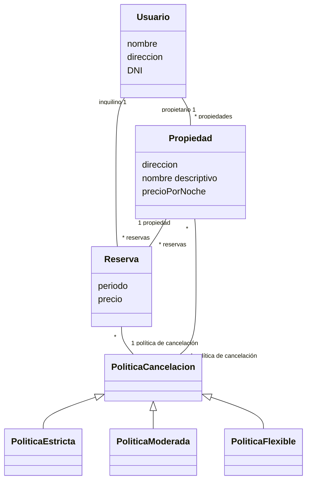
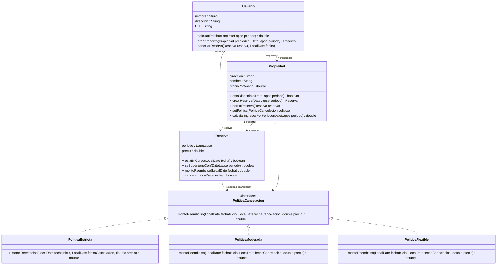

## Ejercicio 23. Políticas de cancelación

A la implementación del ejercicio anterior se quiere extender la funcionalidad de cancelar una reserva de manera tal que calcule el monto que será reembolsado (devuelto) al inquilino. Para hacer esto posible, las propiedades deben conocer una política de cancelación que se define al momento de crearla. Esta política puede ser una de las siguientes: flexible, moderada, o estricta y **puede cambiarse en cualquier momento**.

Al momento de reembolsar, las políticas se comportan de la siguiente manera:

a) **Política de cancelación flexible**: reembolsa el monto total sin importar la fecha de cancelación (que de todas maneras debe ser anterior a la fecha de inicio de la reserva).

b) **Política de cancelación moderada**: reembolsa el monto total si la cancelación se hace hasta una semana antes y 50% si se hace hasta 2 días antes.

c) **Política de cancelación estricta**: no reembolsará nada (0, cero) sin importar la fecha tentativa de cancelación.

Actualice su diseño, implementación y tests de acuerdo a los nuevos requerimientos.

Modelo de dominio: 

Diagrama de clases:

