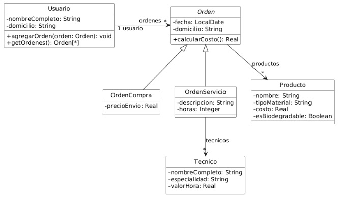

## Ejercicio 24: GreenHOOme
GreenHOOme es una empresa que promueve prácticas sustentables mediante la venta de productos ecológicos y la realización de servicios de mantenimiento en los hogares.

El sistema gestiona a los usuarios del servicio, registrando para cada uno las órdenes de compra de productos y las órdenes de servicio que ha solicitado para el mantenimiento de su hogar. Las órdenes de servicio pueden requerir la intervención de técnicos especializados y el uso de determinados productos, mientras que las órdenes de compra solo registran los productos adquiridos.

El costo de una orden de compra se calcula sumando los valores de los productos adquiridos, mientras que el costo de una orden de servicio se obtiene sumando el costo de los productos utilizados y el valor correspondiente a las horas de trabajo de los técnicos involucrados.

El siguiente diagrama muestra el diseño general de la aplicación:

Uno de los usuarios es Juan Martínez, que vive en Larrea 5800, Mar del Plata, tiene registradas dos órdenes en el sistema de GreenHOOme: una orden de compra y una orden de servicio.

La orden de compra corresponde a la adquisición de productos ecológicos. En este caso, Juan compró un panel solar y una compostera. El panel solar está hecho con materiales reciclables y tiene un costo de 35.000 pesos, mientras que la compostera es un producto biodegradable que cuesta 8.000 pesos. Esta orden se registró con la fecha actual, tiene asociado el domicilio de Juan y no interviene ningún técnico, ya que se trata de una compra directa. El costo total de la orden se obtiene sumando el valor de ambos productos, lo que da un total de 43.000 pesos.

La orden de servicio, en cambio, corresponde a la instalación de un calefón solar en el domicilio del usuario. En esta orden se detalla la descripción del trabajo (“instalación de calefón solar”) y la cantidad de horas estimadas para realizarlo, que son cinco horas. Para llevar a cabo esta tarea participa una técnica llamada Lucía Iraola, cuya especialidad son las instalaciones solares y cuyo valor por hora de trabajo es de 4500 pesos.

Además, para completar la instalación se utilizó un producto: el calefón solar, fabricado con materiales reciclables y con un costo de 50.000 pesos.

El costo total de la orden de servicio se calcula sumando el valor de los productos utilizados más el valor del trabajo de la técnica (cinco horas a 4.500 cada una), lo que da un total de 72.500 pesos.

### Tareas:

1. Instancie los elementos correspondientes al usuario Juan Martínez, incluyendo sus datos personales, sus órdenes (una de compra y una de servicio), los productos y los técnicos asociados a dichas órdenes, de manera consistente con el diseño presentado en el diagrama. Puede hacerlo en un script de código o un test simple donde se verifique los valores totales de las órdenes. Debe definir los constructores necesarios para resolver la tarea.
2. Para incentivar compras y servicios más extensos, si una orden de compra incluye cinco o más productos, o si una orden de servicio requiere más de diez horas de trabajo, se aplica automáticamente un 10% de descuento sobre el costo total. Implemente utilizando JUnit los tests automatizados para el método calcularCosto de una orden, teniendo en cuenta los conceptos de valores de borde y particiones equivalentes vistos en la teoría.
