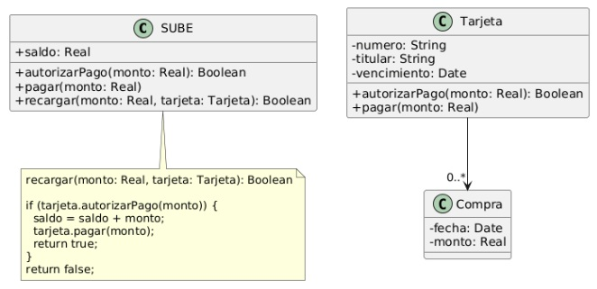
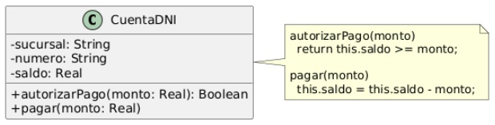

## Ejercicio 29: Interfaces como tipos — Recarga de SUBE
(Al utilizar interfaces como tipos, se emplea una interfaz como tipo común para referirse a objetos de distintas clases)

La SUBE es la tarjeta que usamos para pagar el transporte público. Cuando nos queda poco saldo, podemos recargarla. Actualmente puede recargarse utilizando una tarjeta.

El método `recargar(monto, tarjeta)` consulta a la tarjeta recibida si autoriza el pago por el monto indicado. Si lo autoriza, incrementa el saldo de la SUBE, solicita a la tarjeta que efectúe el pago y retorna `true`. En caso contrario, no modifica el saldo ni realiza el pago y retorna `false`.

Se desea ampliar el sistema para que las recargas también puedan abonarse con Cuenta DNI. De cada cuenta se conoce la sucursal, el número y el saldo disponible.

### Tareas:

#### 1. ¿Qué comportamiento tienen en común Tarjeta y CuentaDNI que permita utilizarlas indistintamente para abonar una recarga?

Ambas comparten firma y comportamiento de los métodos `autorizarPago(monto : Real) : Boolean` y `pagar(monto : Real)`.

#### 2. Modifique el diseño para que un único método recargar permita recargar una SUBE utilizando cualquiera de las dos. 

Se crea la interfaz `MedioDePago` que fuerza a implementar ambos métodos, y es implementada por `CuentaDNI` y `Tarjeta`. 

El método `recargar(monto : Real, tarjeta : Tarjeta)` pasa a recibir un objeto de una clase que implemente `MedioDePago`, `recargar(monto : Real, medioDePago : MedioDePago)`

#### 3. Implemente los cambios en Java.
