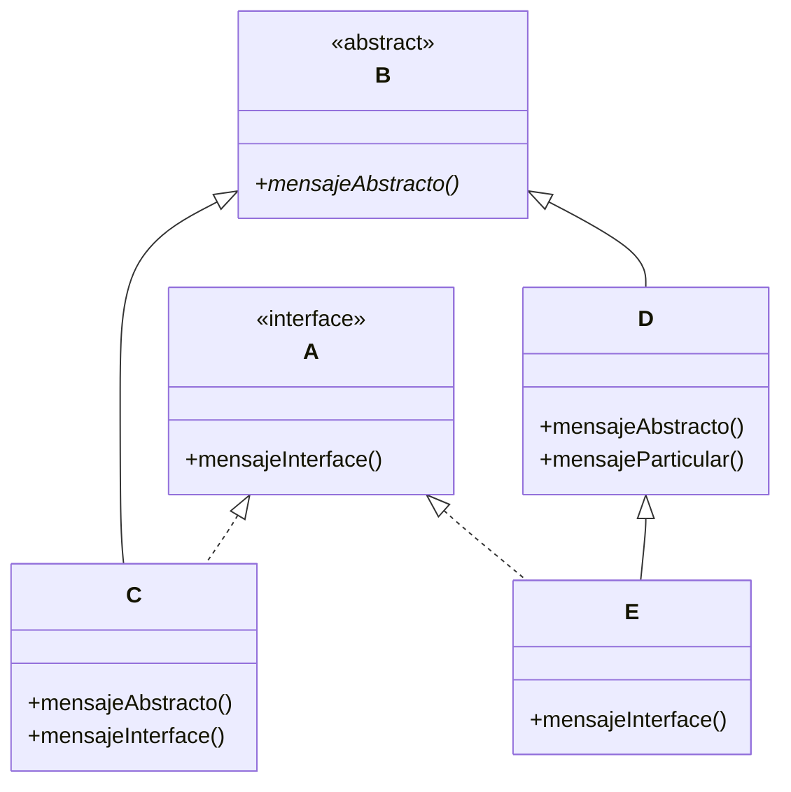

## Ejercicio 33. TipadOOs



### Tarea: Dado el diagrama de clases UML proporcionado, complete todos los bloques de código reemplazando los signos de interrogación (???) con los tipos y métodos correctos. Escriba todas las combinaciones válidas posibles.

### 1)
```java
A objeto = new ???();
objeto.???();
```

Respuesta:

```java
A objeto = new C();
objeto.mensajeInterface();
```
```java
A objeto = new E();
objeto.mensajeInterface();
```

### 2)
```java
B objeto = new ???();
objeto.???();
```

Respuesta:

```java
B objeto = new C();
objeto.mensajeAbstracto();
```

```java
B objeto = new D();
objeto.mensajeAbstracto();
```

```java
B objeto = new E();
objeto.mensajeAbstracto();
```


### 3)
```java
D objeto = new ???();
objeto.???();
```

Respuesta:

```java
D objeto = new D();
objeto.mensajeAbstracto();
objeto.mensajeParticular();
```

```java
D objeto = new E();
objeto.mensajeAbstracto();
objeto.mensajeParticular();
```

### 4)
```java
C objeto = new C();
objeto.???();
```

Respuesta:

```java
C objeto = new C();
objeto.mensajeAbstracto();
objeto.mensajeInterface();
```

### 5)
```java
??? objeto = new C();
objeto.mensajeAbstracto();
```

Respuesta:

```java
C objeto = new C();
objeto.mensajeAbstracto();
```

```java
B objeto = new C();
objeto.mensajeAbstracto();
```

### 6)
```java
??? objeto = new C();
objeto.mensajeInterface();
```

Respuesta:

```java
C objeto = new C();
objeto.mensajeInterface();
```


```java
A objeto = new C();
objeto.mensajeInterface();
```
