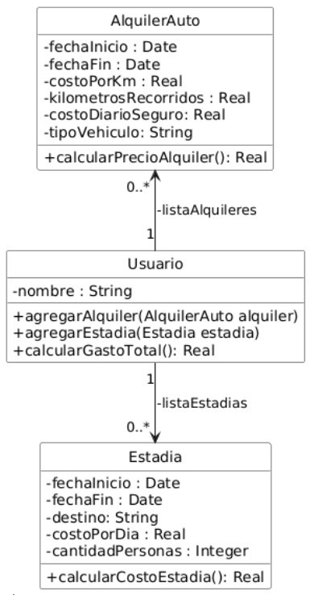
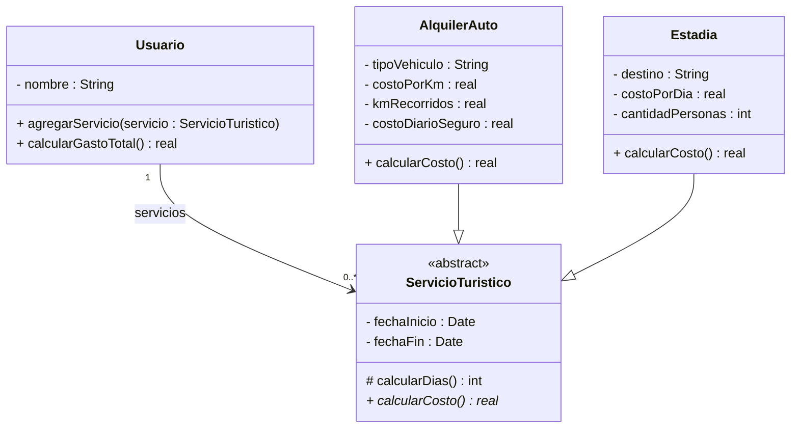

## Ejercicio 35. Servicios turísticos

Se tiene un sistema para registrar los servicios turísticos contratados por un usuario, que incluyen estadías en alojamientos y alquileres de vehículos. Actualmente, la clase Usuario mantiene dos colecciones separadas para cada tipo de servicio, como se muestra en el siguiente diagrama.



```java 
public class Usuario {
private String nombre;
private List<AlquilerAuto> listaAlquileres;
private List<Estadia> listaEstadias;

    public Usuario(String nombre) {
        this.nombre = nombre;
        this.listaAlquileres = new ArrayList<>();
        this.listaEstadias = new ArrayList<>();
    }
        
    public void agregarAlquiler(AlquilerAuto alquiler){
        listaAlquileres.add(alquiler);
    }
    
    public void agregarEstadia(Estadia estadia) {
        listaEstadias.add(estadia);
    }
    
    public double calcularGastoTotal() {
        double total = 0;
        for (AlquilerAuto a : listaAlquileres) {
            total = total + a.calcularPrecioAlquiler();
        }
        for (Estadia e : listaEstadias) {
            total = total + e.calcularCostoEstadia();
        }
        return total;
    }  
}

public class Estadia {
    private String destino;
    private double costoPorDia;
    private LocalDate fechaInicio, fechaFin;
    private int cantidadPersonas;
    
    public Estadia(String destino, double costoPorDia, LocalDate fechaInicio, LocalDate fechaFin, int cantidadPersonas){
        // asigna cada parámetro a la variable de instancia 
        }
    
    public double calcularCostoEstadia() {
        long dias = ChronoUnit.DAYS.between(fechaInicio, fechaFin);
        return dias * costoPorDia * cantidadPersonas;
    }
}

public class AlquilerAuto {
    private double costoPorKm, kilometrosRecorridos, costoDiarioSeguro;
    private LocalDate fechaInicio, fechaFin;
    private String tipoVehiculo;
    
    public AlquilerAuto(double costoPorKm, double kilometrosRecorridos, LocalDate fechaInicio, LocalDate fechaFin, String tipoVehiculo, double costoDiarioSeguro) {
        // asigna cada parámetro a la variable de instancia correspondiente
    }

    public double calcularPrecioAlquiler () {
        long dias = ChronoUnit.DAYS.between(fechaInicio, fechaFin);
        return (costoPorKm * kilometrosRecorridos) + (costoDiarioSeguro * dias);
    }
}
```

### Tareas:
**1.** Rediseñe lo necesario para permitir que la clase Usuario mantenga una única colección de servicios contratados, evitando duplicación de código y calculando los costos polimórficamente. Aplique los conceptos vistos en la materia. Realice un diagrama de clases UML completo de su diseño (incluyendo los métodos).



**2.** Reimplemente en Java respetando el nuevo diseño.
