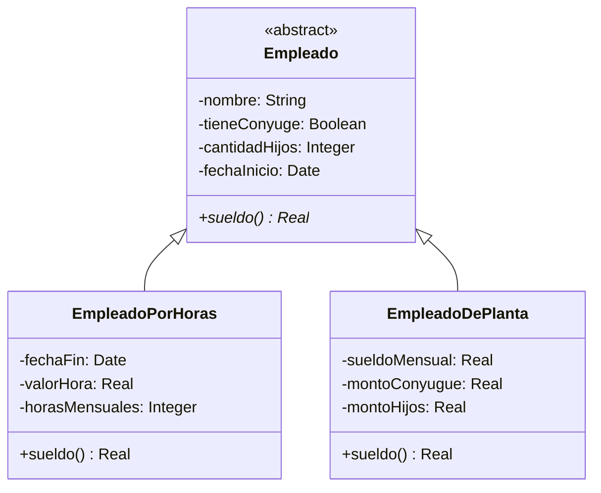
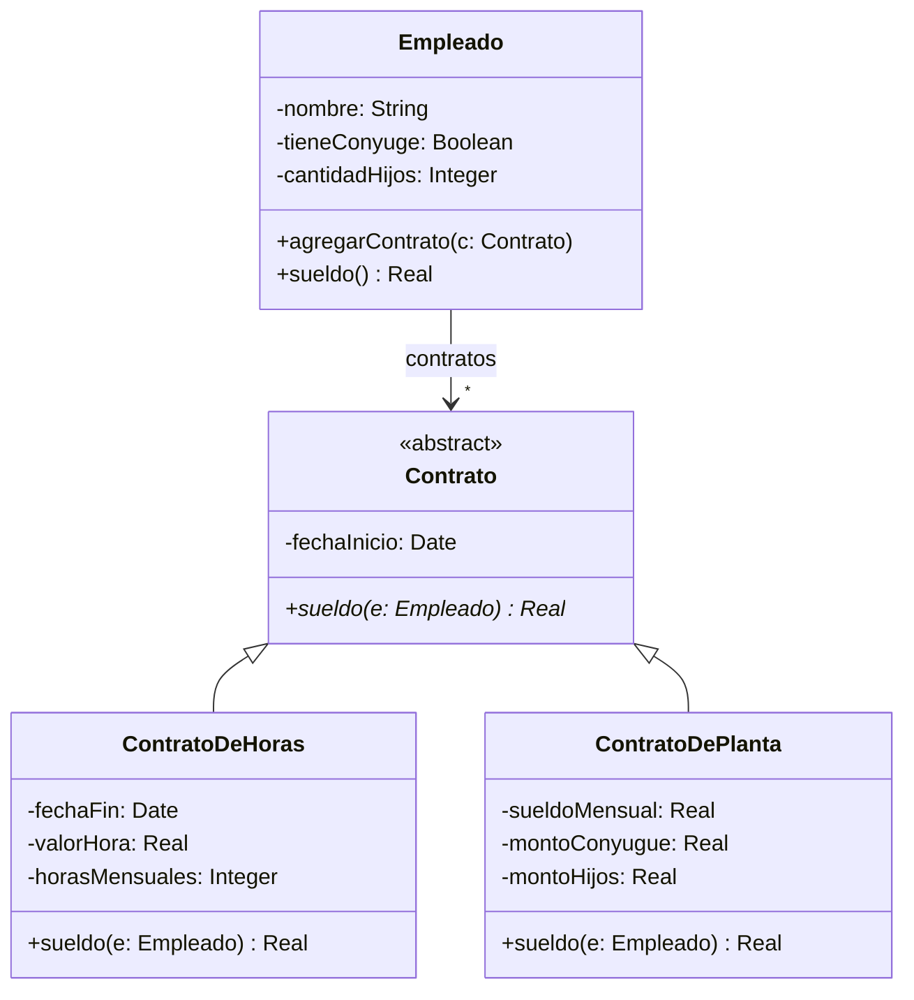

## Ejercicio 36. Comparando dos diseños

A continuación se presentan dos posibles modelos para un sistema de administración de personal.

### Solución (A)

### Solución (B)

### Tarea

Marque con una sola X la opción que considere correcta para cada afirmación.

| Afirmación | Solo (A) | Solo (B) | Ambos | Ninguno |
|---|:---:|:---:|:---:|:---:|
| 1- Permite al empleado cambiar de contrato dinámicamente. | | X| | |
| 2- Permite que un empleado tenga múltiples contratos simultáneamente. | | X| | |
| 3- Es posible extender el diseño para tener nuevos empleados con un nuevo tipo de contrato. | | | X| |
| 4- Permite reutilizar la implementación de "contrato por horas" en otro sistema sin llevarme todo el código de Empleado. | | | | X|
| 5- Si agrego un atributo nuevo a Empleado, automáticamente lo tienen todos los tipos de contrato. | | | X| |
| 6- Permite tener un empleado sin contrato. | | X| | |
| 7- Permite testear que el cálculo de sueldo funciona bien sin necesidad de crear empleados. | | | | X|
| 8- El empleado delega a otro objeto el cálculo del sueldo. | | X| | |
| 9- Si agrego la implementación de un nuevo tipo de contrato, la **clase Empleado** existente **NO** cambia. | | |X | |
| 10- Para cambiar un contrato se debe instanciar un nuevo empleado. | X| | | |